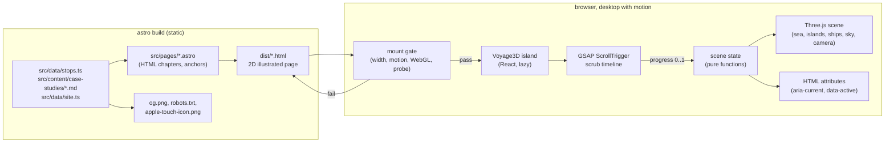
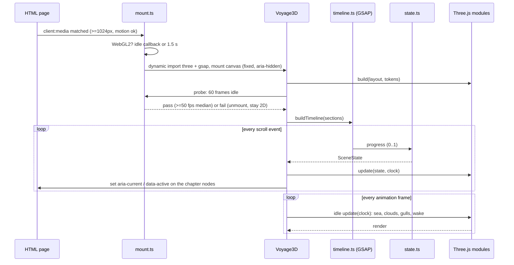
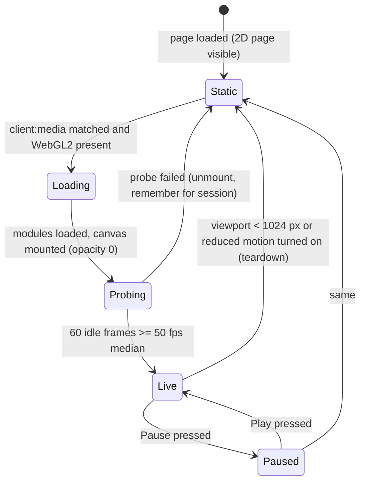
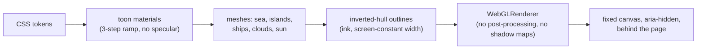

# Architecture: the 3D voyage

System design for the redesign specified in `docs/superpowers/specs/2026-10-17-3d-voyage-redesign-design.md`. This document covers how the pieces fit, what talks to what, and the budgets; the spec covers what the visitor experiences and why.

## 1. Overview

The site stays a static Astro build. One React island, `Voyage3D`, renders a fixed full-viewport Three.js scene behind the server-rendered page on desktop only. A single scroll-progress value, produced by GSAP ScrollTrigger from the page's own scroll, drives every change in the scene. The HTML remains the source of truth for content, scroll length, keyboard order, crawlers and the phone experience.



## 2. Module map

```
src/
  data/stops.ts            stop data (unchanged): id, place, chapter, role, dates, shipSize, milestone, map, sizeSwap
  data/site.ts             site facts (unchanged)
  content/case-studies/    the eight case studies (unchanged)
  pages/index.astro        chapter order and anchors (unchanged); mounts Voyage3D once
  components/voyage/
    VoyageTimeline.astro   the stop list and the still chart (the 2D page's voyage chapter)
    route.ts               route geometry: buildRoute, pointAt, shipHeading, activeIndexFor (unchanged, reused)
  components/scene/        NEW: the 3D voyage
    Voyage3D.tsx           the island: mount gate, canvas, resize, pause control, teardown
    mount.ts               canMount(env) and the GPU probe (pure where possible)
    timeline.ts            buildTimeline(stops, entries): the ScrollTrigger scrub, dwell schedule, chapter spans
    state.ts               sceneStateAt(progress, layout): ship position/heading, hull index, active chapter, port rise, sun angle, card phases (pure)
    layout.ts              worldLayout(stops, entries): projects stop coordinates to world space, builds the route spline, places islands, the harbour, the camera spline (pure)
    materials.ts           toon materials from tokens, the outline helper, the sky dome shader
    sea.ts                 sea plane geometry + displacement + foam + wake
    islands.ts             island and harbour builders
    ships.ts               procedural hull generator (three sizes, harbour variants, the tarp)
    sky.ts                 sky dome, sun, clouds, gulls
    camera.ts              chase camera along the camera spline
    tokens.ts              reads the brand colours from CSS custom properties at mount
  styles/
    tokens.css             brand tokens + the scene colour tokens (single source for CSS and WebGL)
    scene.css              fixed canvas layer, card panels, the 2D painted header band
```

Boundaries:

- `layout.ts` and `state.ts` are pure: data in, numbers out, no DOM, no Three.js. They are unit-tested and shared with nothing else.
- `timeline.ts` owns GSAP. It is the only module that touches scroll.
- `sea.ts`, `islands.ts`, `ships.ts`, `sky.ts`, `camera.ts`, `materials.ts` own Three.js objects. Each exports a `build(...)` returning an object with `update(state, clock)` and `dispose()`.
- `Voyage3D.tsx` is the only React component. It composes the above and owns lifecycle.
- The HTML page and the 2D page know nothing about the scene except two things: chapter sections carry `data-scene-chapter` and stops carry `data-stop-id`, which the island reads to map scroll spans.

## 3. Data flow



Two clocks: scroll progress (the voyage) and wall time (idle life). `update(state, clock)` receives both so each module decides what it follows.

## 4. Interfaces

```ts
// layout.ts
export interface WorldLayout {
  route: CatmullRomCurve3;          // the ship's path in world units
  cameraPath: CatmullRomCurve3;     // parallel, offset back and up
  stops: Array<{ id: string; t: number; position: Vector3; island: IslandSpec; sizeSwap: boolean }>;
  harbour: { t0: number; t1: number; berths: Array<{ id: string; t: number; position: Vector3; classified: boolean }> };
  chapters: Array<{ id: string; t0: number; t1: number }>; // scroll spans in route-t
}
export function worldLayout(stops: readonly Stop[], entries: readonly LogEntryData[]): WorldLayout;

// state.ts
export interface SceneState {
  t: number;                        // route progress 0..1 (eased, dwell-aware)
  shipPosition: Vector3; shipHeading: number; hull: 0 | 1 | 2; swapPhase: number; // 0 outside a swap
  cameraPosition: Vector3; cameraLookAt: Vector3;
  activeChapter: string | null; activeStop: string | null; activeBerth: string | null;
  portRise: Record<string, number>; // 0..1 per island
  cardPhase: Record<string, 'before' | 'arriving' | 'held' | 'leaving' | 'after'>;
  sunAngle: number; skyMix: number; // 0 dawn .. 1 late
}
export function sceneStateAt(progress: number, layout: WorldLayout): SceneState;

// timeline.ts
export interface VoyageTimeline { progress(): number; scrollTo(t: number): void; refresh(): void; kill(): void; }
export function buildTimeline(sections: HTMLElement[], onUpdate: (p: number) => void): VoyageTimeline;

// scene modules
export interface SceneModule { object: Object3D; update(state: SceneState, clock: { t: number; dt: number }): void; dispose(): void; }

// mount.ts
export interface MountEnv { width: number; reducedMotion: boolean; webgl2: boolean; paused: boolean; }
export function canMount(env: MountEnv): boolean;
export function probe(render: () => void, frames?: number): Promise<{ medianFps: number; pass: boolean }>;
```

Everything the scene needs about content comes through `WorldLayout`; nothing reads the DOM for content.

## 5. Island state machine



The canvas fades in only after the probe passes, so a failed probe is invisible to the visitor. The 2D page is always rendered underneath; the island never removes or moves HTML.

## 6. Scroll mapping

The page's chapter sections set the scroll length. `buildTimeline` creates one ScrollTrigger over the page from the top of the first chapter to the bottom of the last, `scrub: 0.6`, and maps the sections to route spans by their offsets:

| Chapter | Share of scroll | Scene span |
| --- | --- | --- |
| Hero | 8% | ship at the start, dawn |
| Career stops (9) | 32% | equal legs, 22% dwell per leg |
| Captain's Log harbour (8 berths) | 40% | equal berths, 30% dwell per berth |
| About | 10% | approach to the last island |
| Contact | 10% | moored at the last island, late light |

Anchor navigation (`#log`, `#stop-<id>`, `#entry-<id>`) resolves to a route-t and calls `scrollTo`, which uses native smooth scrolling to the matching page offset; the scrub then animates the voyage there. No wheel interception, no snapping.

## 7. Rendering pipeline



Choices that keep it cheap: no post-processing pass (outlines are geometry), no shadow maps, alpha test instead of blending, a single directional light plus hemisphere, device pixel ratio capped at 1.5, the sea plane at 160 by 160 segments displaced in the vertex shader, instanced spheres for clouds, sprites for gulls.

## 8. Budgets and gates

| Surface | Budget | Enforced by |
| --- | --- | --- |
| Phone: client JS | unchanged (no island) | size-limit, Lighthouse mobile |
| Phone: Lighthouse | LCP 1,700 ms error, CLS 0.1, a11y 1.0, byte budgets | lhci in CI |
| Desktop: deferred bundle (three + gsap + scene) | 400 kB gzipped | size-limit, new tier |
| Desktop: first paint path | unchanged (island deferred) | Lighthouse desktop run, manual |
| Desktop: frame rate | 50 fps median, no frame over 32 ms, 4x throttle | `scripts/perf-trace.mjs` protocol |
| Mount shift | 0 attributed to the island | e2e layout-shift observer |
| Security | CSP without unsafe-inline; WebGL needs nothing extra | e2e violation listener |
| IP | denylist scan clean | `npm run ip-scan` in CI |

## 9. Testing map

| Layer | What | Where |
| --- | --- | --- |
| Unit | `worldLayout`: every stop placed, route monotonic, harbour berths in `order`, chapter spans sum to 1 | `tests/unit/scene-layout.test.ts` |
| Unit | `sceneStateAt`: hull index by milestone, dwell holds the ship at the port, card phases in order, sun from dawn to late | `tests/unit/scene-state.test.ts` |
| Unit | `canMount`: every gate; probe math | `tests/unit/scene-mount.test.ts` |
| Unit | 2D page contract: chapters, stops, entries, links, no phone in head (existing tests, kept) | existing |
| E2E | desktop mounts only with width, motion, WebGL; aria-current advances; pause; anchor sails; zero shift; no CSP violation | `tests/e2e/voyage-3d.spec.ts` |
| E2E | phone and reduced motion never request three; JS off and WebGL off read everything; keyboard order; axe | existing voyage specs extended |
| Protocol | trace under throttle; Safari by hand; skeptic sign-off | `docs/ci-gates.md` |

## 10. Decisions

- **Three.js rather than a 2D canvas or SVG world:** the owner chose a full 3D voyage; the toon pipeline keeps it drawn rather than rendered.
- **Geometry built in code rather than model files:** no licensing, no IP exposure, tiny bytes, one consistent look, and the three ship sizes come from one generator.
- **ScrollTrigger kept as the scroll engine:** already in the repo, already proven at 60 fps, and its scrub smoothing is what the ship's motion needs.
- **Inverted-hull outlines instead of a post-processing edge pass:** no extra render target, works on every GPU the site targets, and the line width is controllable per object.
- **A mount-time probe with a 2D fallback instead of a device allow-list:** the only honest way to know a machine can hold the frame bar.
- **The HTML page stays complete without the island:** the four non-negotiables depend on it, and it is what phones, crawlers and screen readers use.
